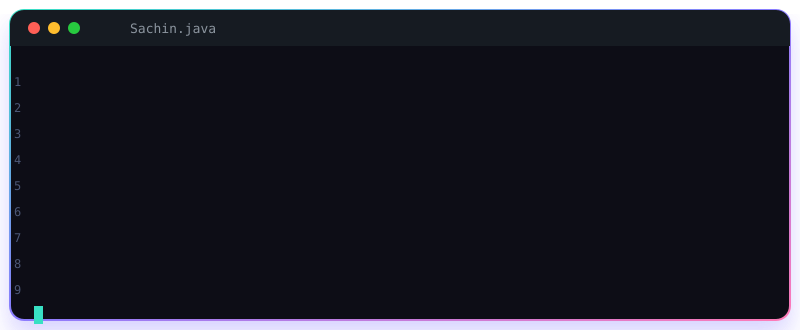
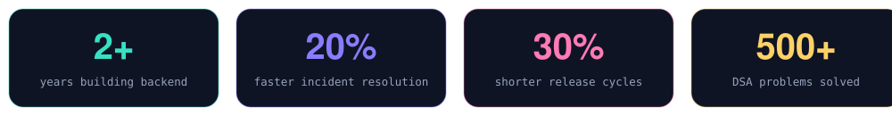

<!-- 

  

  

  <a href="https://www.linkedin.com/in/sachin-nagar-dev/">LinkedIn</a> ·
  <a href="https://github.com/TheSachinDhakad">GitHub</a> ·
  <a href="https://leetcode.com/sachin-nagar-dev/">LeetCode</a> ·
  <a href="mailto:sachindhakad568@gmail.com">Email</a>

  

## 🛠️ Skills

  

## 💼 Experience

  

 -->

<!-- 

  

  

  

  <a href="https://www.linkedin.com/in/sachin-nagar-dev/">LinkedIn</a> ·
  <a href="https://github.com/TheSachinDhakad">GitHub</a> ·
  <a href="https://leetcode.com/sachin-nagar-dev/">LeetCode</a> ·
  <a href="mailto:sachindhakad568@gmail.com">Email</a>

  

## 🛠️ Skills

  

## 💼 Experience

  

 -->

  

  
  
  
  
  

  

## 👨‍💻 About me

  

## 🛠️ Tech stack

  

## 💼 Career path

  

## 🚀 Featured projects

| Project | Stack | What it does |
|---|---|---|
| **[Fitness AI Tracking Platform](https://github.com/TheSachinDhakad/FitnessAI)** | Java, Spring Boot, RabbitMQ, Eureka, MongoDB, Docker | Three microservices (user, activity, AI recommendation) that talk through RabbitMQ events |
| **Quick Commerce Platform** | React, Node.js, MongoDB, Razorpay | Multi-vendor store with JWT-secured APIs, live order tracking and webhook-confirmed payments |
| **Inventory Billing Software** | MERN, JWT | Role-based access, real-time stock tracking and barcode-scan billing |

## 🏆 Achievements and certifications

- 🥇 1st place, state-level technical solution design hackathon, and winner of a college-level hackathon
- 🏅 Best Performance, TCS Initial Learning Program (ILP)
- ☁️ Oracle Cloud Infrastructure 2025: AI Foundations, Foundations, Data Platform Foundations (Associate)
- 🤖 Oracle Fusion AI Agent Studio Foundations (Associate)

## 📊 GitHub activity

  
  

  

<i>Open to backend roles. Say hello at <a href="mailto:sachindhakad7265@gmail.com">sachindhakad7265@gmail.com</a></i>
