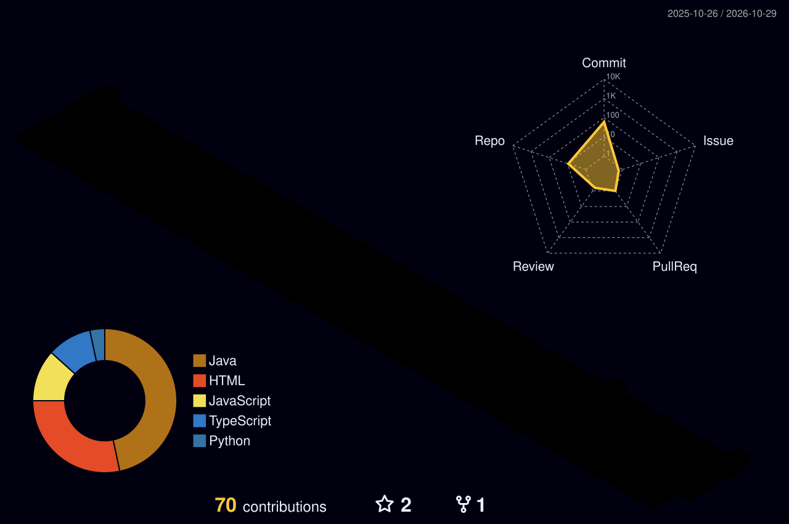

<!-- profile banner -->
<p align="center">
  
</p>

<p align="center">
  
</p>

<p align="center">
  
  
  
</p>

<p align="center">
  
</p>

<!-- animated code window (assets/terminal.svg) -->
<p align="center">
  
</p>

---

# 💫 About Me

```java
public class Sachin implements Engineer {
    String role  = "Backend Software Engineer";
    String now   = "Senior Executive @ IB Group";     // IoT dashboards, SQL pipelines
    String past  = "TCS, Vanguard client";            // Spring Boot, AWS, Kafka
    String[] learning = {"System Design", "AWS", "Kubernetes", "Advanced Microservices"};
}
```

- 💼 Senior Executive at **IB Group**, building real-time IoT dashboards with **Node-RED & Grafana**
- 🏦 Previously Software Engineer at **TCS** on the **Vanguard** client
- 🌱 Learning **System Design, AWS, Kubernetes & Advanced Microservices**
- 🔥 Passionate about **Backend Engineering & Scalable Systems**
- 💬 Ask me about:
  - Java
  - Spring Boot
  - Microservices
  - REST APIs
  - AWS
  - Docker
  - CI/CD
  - RabbitMQ & Kafka
  - OAuth2/JWT

- ⚡ Strong understanding of:
  - Distributed Systems
  - Saga Design Pattern
  - Cloud-Native Applications
  - CI/CD Automation
  - Scalable Architecture

- 📫 Reach me at:
  **sachindhakad568@gmail.com** · **sde.sachinnagar@gmail.com**

---

# 🌐 Connect With Me

<p align="center">

<a href="https://www.linkedin.com/in/sachin-nagar-dev/" target="_blank">
  
</a>

<a href="https://instagram.com/thesachindhakad" target="_blank">
  
</a>

<a href="https://leetcode.com/sachin-nagar-dev/" target="_blank">
  
</a>

<a href="https://www.hackerrank.com/profile/sachindhakad7265" target="_blank">
  
</a>

<a href="https://github.com/TheSachinDhakad" target="_blank">
  
</a>

</p>

---

# 🛠️ Tech Stack

<p align="center">
  
</p>

## 🚀 Languages

<p align="center">
  
</p>

## ⚙️ Backend Development

<p align="center">
  
</p>

## 🗄️ Databases

<p align="center">
  
</p>

## ☁️ Cloud & DevOps

<p align="center">
  
</p>

## 🔥 Tools & Technologies

<p align="center">


</p>

---

# 💼 Experience

<p align="center">
  
</p>

## 🏢 IB Group
### Senior Executive

📅 Oct 2026 – Present

- Architected and deployed real-time IoT dashboards with Node-RED and Grafana across live facility units
- Built Node.js and Python data ingestion pipelines with multi-source telemetry parsing and automated reconciliation
- Wrote SQL query patterns and aggregation jobs for equipment uptime and daily executive performance reports
- Configured Grafana alerting and fault-tolerance triggers to notify teams of anomalies quickly

---

## 🏢 Tata Consultancy Services (TCS)
### Software Engineer | Vanguard Client

📍 Indore, Madhya Pradesh  
📅 June 2025 – Oct 2026

- Developed scalable microservices using Spring Boot
- Implemented Saga Design Pattern for distributed transactions
- Worked with MySQL, DB2 & DynamoDB
- Built AWS Lambda serverless solutions
- Automated deployments using Jenkins & Docker
- Monitored applications using Splunk & Honeycomb
- Improved deployment efficiency by 30%
- Implemented OAuth 2.0 and RBAC on transactional endpoints within a 99.9% uptime SLA
- Cut incident resolution time by 20% and query latency by 35%

---

## 🏢 Stepfinity
### Software Engineer

📍 Bhopal, Madhya Pradesh  
📅 Apr 2025 – May 2025

- Built REST APIs integrated with OutSystems
- Integrated Shopify APIs
- Resolved production issues and improved workflows

---

## 🏢 Tryidol
### Software Engineer Intern

📍 Bhopal, Madhya Pradesh  
📅 Oct 2024 – Mar 2025

- Developed secure JWT/OAuth2 APIs
- Deployed services on AWS EC2
- Managed databases using AWS RDS

---

## 🏢 Zappian Media

### Backend Developer Intern

📍 Bhopal, Madhya Pradesh  
📅 Feb 2024 – Jul 2024

- Worked on scalable messaging systems
- Integrated SMS APIs
- Automated deployment pipelines

---

## 🏢 Avyaan Management
### Backend Developer Intern

📍 Bhopal, Madhya Pradesh  
📅 Jun 2023 – Dec 2023

- Cut audio processing time by 40% with a multilingual Python transcription tool
- Built HRMS, CRM and Warehouse Management backend modules

---

# 🚀 Featured Projects

## 🏋️ Fitness Tracking Platform

### Tech Stack:
Java • Spring Boot • RabbitMQ • Eureka • MongoDB

- Built microservices architecture
- Event-driven communication using RabbitMQ
- Service discovery with Eureka
- Developed scalable REST APIs

---

## 🛒 Quick Commerce Platform

### Tech Stack:
MERN • AWS • Razorpay

- Multi-vendor e-commerce platform
- Secure payment integration
- AWS EC2 & S3 deployment
- Optimized backend APIs

---

## 📦 Inventory Billing Software

### Tech Stack:
MERN • JWT Authentication

- Role-based access control
- Real-time inventory tracking
- Barcode scanning system

---

# 🎓 Education

| Qualification | Institution | Year | Result |
|---|---|---|---|
| B.Tech (CSE) | NRI Institute of Information Science & Technology, Bhopal | 2024 | 8.56 CGPA |
| Class XII | Govt. Gandhi Higher Secondary School, Pachore | 2020 | 81.0% |
| Class X | Govt. High School, Kodiya Jargar | 2018 | 89.0% |

---

# 🏆 Achievements

- ✅ Solved **500+ DSA Problems** on LeetCode
- 🏅 Best Performance Award in TCS ILP Training
- 🥇 1st place, state-level technical solution design hackathon
- ☁️ Oracle Cloud Certified
- 🚀 Built Production-Level Microservices Applications

---

# 📜 Certifications

- Oracle Cloud Infrastructure AI Foundations Associate
- Oracle Cloud Infrastructure Foundations Associate
- Oracle Data Platform Foundations Associate
- Oracle Fusion AI Agent Studio Foundations Associate
- Anthropic Claude Certified

---

# 🧊 My Contributions in 3D

<p align="center">
  
</p>

---

# 📊 GitHub Analytics

<p align="center">
  
  
</p>

<p align="center">
  
</p>

<p align="center">
  
</p>

---

# 🎯 Current Focus

✅ Advanced Java  
✅ System Design  
✅ AWS Cloud  
✅ Kubernetes  
✅ Scalable Microservices  
✅ Distributed Systems  
✅ CI/CD Automation  

---

# 🤝 Let's Build Something Amazing Together!

<p align="center">
  <a href="mailto:sachindhakad568@gmail.com">
    
  </a>
</p>

<h3 align="center">⭐ From Sachin Nagar ⭐</h3>

<p align="center">
  
</p>
